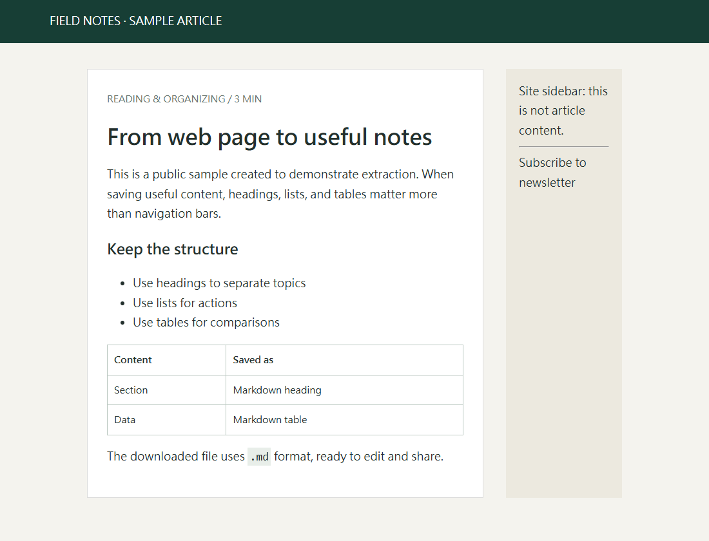
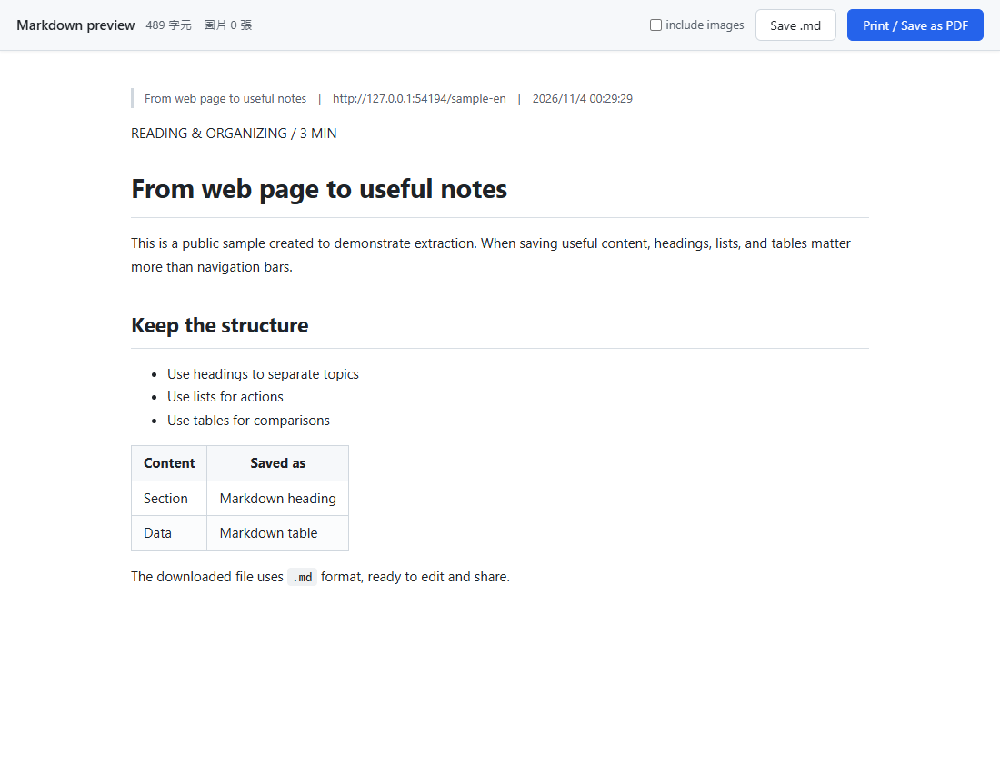

# chrome-md

[English](README.md) · [繁體中文](README.zh-TW.md)

A Chrome extension that saves the current web page as Markdown (`.md`) — clean output for AI agents to read: real Markdown tables, absolutized links, headings/lists/code preserved, and nav/ads/cookie banners/comment sections stripped.

## In action

A bundled sample article, captured in Chromium with the real extension loaded. Navigation and the sidebar are removed; headings, lists, and the table remain.

## Install (one time)

1. Open `chrome://extensions`
2. Turn on **Developer mode** (top right)
3. Click **Load unpacked** (top left)
4. Select this folder

No build step, no dependencies — everything you need is in the repo.

## Use

| What you want | How |
|---|---|
| Save this page as `.md` | Click the toolbar icon, or `Ctrl+Shift+M` |
| Save only the selection | Select text → right-click → "Save as Markdown (selection)" |
| Force-save the whole page | Right-click → "Save as Markdown (full page)" |
| Save / print as PDF | On the preview tab: "Print / Save as PDF" or `Ctrl+P` |
| Download the `.md` file | On the preview tab: "Save .md" or `Ctrl+S` |

Clicking opens a **Markdown preview** tab. There, "Save .md" defaults to **not** embedding images (small file, ideal for agents); check "include images" to inline them as base64 (file gets much larger).

## Notes

- `chrome://` pages, the Web Store, Chrome's built-in PDF viewer and the new tab page can't be injected — the icon shows a ✕ there.
- The extension name, menu items, and primary preview controls follow your browser language (English and Traditional Chinese are bundled; `_locales/`). Some preview counters and timestamps currently retain Traditional Chinese labels or formatting. On a Traditional-Chinese browser you'll see the extension name as 「另存為 Markdown」, and the right-click menu items 「另存為 Markdown（整頁）」 (= full page) and 「另存為 Markdown（只存選取範圍）」 (= selection only).
- Extraction lives in the single content script `content.js`; vendored libraries: [turndown](https://github.com/mixmark-io/turndown) (HTML→Markdown) and [marked](https://github.com/markedjs/marked) (Markdown→HTML preview), both MIT.

## License

MIT — see [LICENSE](LICENSE).
