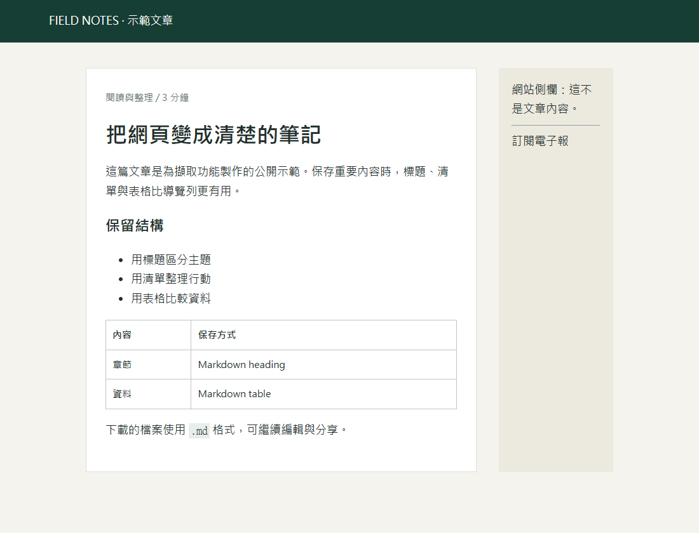
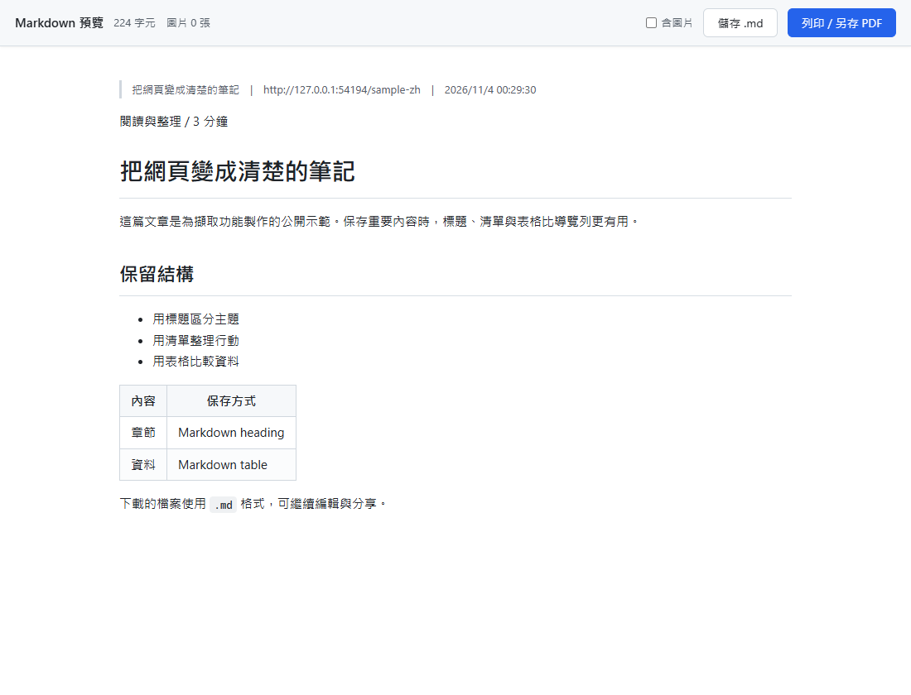

# chrome-md

[English](README.md) · [繁體中文](README.zh-TW.md)

一個 Chrome 擴充功能，可將目前的網頁另存為 Markdown（`.md`）——輸出乾淨、適合 AI 代理閱讀：保留真正的 Markdown 表格、連結轉為絕對網址、標題／清單／程式碼原樣保留，並去除導覽列、廣告、Cookie 橫幅與留言區。

## 實際畫面

以下使用自製示範文章，在 Chromium 載入真正的擴充功能後擷取。導覽與側欄會移除，標題、清單及表格會保留。

## 安裝（一次即可）

1. 開啟 `chrome://extensions`
2. 開啟**開發人員模式**（右上角）
3. 點選**載入未封裝項目**（左上角）
4. 選取這個資料夾

不需要建置步驟，也沒有任何相依套件——你需要的東西都在這個 repo 裡。

## 使用

| 你想做什麼 | 怎麼做 |
|---|---|
| 把這一頁另存為 `.md` | 點一下工具列圖示，或按 `Ctrl+Shift+M` |
| 只存選取範圍 | 選取文字 → 按右鍵 → 「另存為 Markdown（只存選取範圍）」 |
| 強制存整頁 | 按右鍵 → 「另存為 Markdown（整頁）」 |
| 另存／列印成 PDF | 在預覽分頁：「Print / Save as PDF」或 `Ctrl+P` |
| 下載 `.md` 檔案 | 在預覽分頁：「Save .md」或 `Ctrl+S` |

點了之後會開啟一個 **Markdown 預覽** 分頁。在那裡，「Save .md」預設**不**內嵌圖片（檔案小，最適合 AI 代理）；勾選「include images」可把圖片以 base64 內嵌（檔案會大非常多）。

## 說明

- `chrome://` 頁面、Chrome 線上應用程式商店、Chrome 內建 PDF 檢視器與新分頁都無法注入——在這些頁面上，圖示會顯示 ✕。
- 擴充功能名稱、選單與預覽主要按鈕會跟隨瀏覽器語言（內建英文與繁體中文；位於 `_locales/`）。部分預覽計數與時間目前仍使用繁體中文標示或格式。在繁體中文瀏覽器上，你會看到擴充功能名稱為「另存為 Markdown」，右鍵選單項目為「另存為 Markdown（整頁）」（= full page）與「另存為 Markdown（只存選取範圍）」（= selection only）。
- 擷取邏輯集中在單一 content script `content.js`；內附的函式庫：[turndown](https://github.com/mixmark-io/turndown)（HTML→Markdown）與 [marked](https://github.com/markedjs/marked)（Markdown→HTML 預覽），兩者皆為 MIT 授權。

## 授權條款

MIT — 詳見 [LICENSE](LICENSE)。
